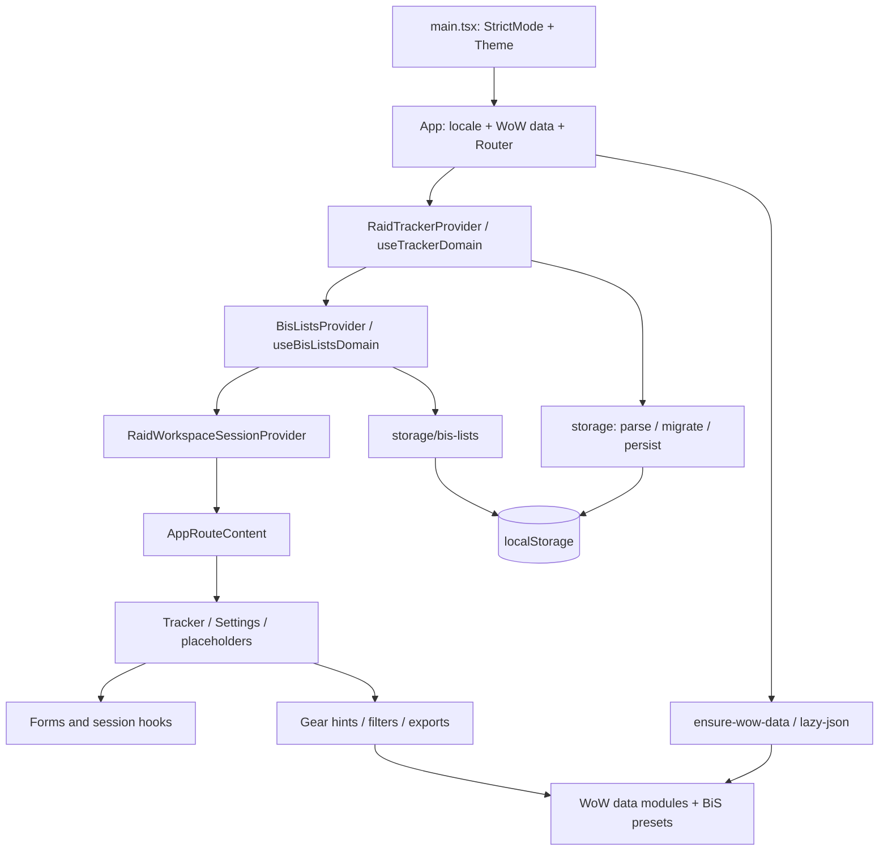

# Архитектура, технический долг и план

## Карта текущей системы

Расположение провайдеров над routes сохраняет состояние workspace при переходах.
Persistent domain и session state разделены; временные настройки не обязаны переживать reload.
Это полезное свойство, которое следует сохранить при рефакторинге.

## Что уже сделано хорошо

- Strict TypeScript, colocated tests, отдельные типы domain и storage, последовательные версии миграций.
- Большая часть сложной логики вынесена из компонентов в проверяемые функции: фильтры, совместимость предметов, hints, export, soft rolls.
- Функциональные state updates в ключевых мутациях; удаление сущностей очищает зависимые toggles.
- BiS slot maps кэшируются. В таблице есть `memo` с сравнением конкретной ячейки CD, а не только всего объекта toggles; это уже целевая оптимизация.
- UI-каталоги EN/RU связаны типом `Messages`; локализуются storage errors, формы и доменные подписи.
- WoW JSON выделен в chunks, шрифты локальные, tooltip scripts запрашиваются при взаимодействии.
- CI включает lint, coverage, build, browser smoke и проверку согласованности релизных файлов. Тесты проверяют не только rendering, но и substantial domain behavior.

## Долг и рекомендуемые границы

| ID | Наблюдение и свидетельство | Последствие и предлагаемое действие | Приоритет |
|---|---|---|---|
| D01 | Tracker/BiS имеют разные load/save/error/unmount контракты; см. F01–F05, F08 | Ввести общий контракт результата чтения и записи, блокировку автозаписи после failed load, политику revision и flush; доменные сериализаторы оставить отдельными | P1 |
| D02 | [RaidWorkspaceSessionProvider](../../../src/contexts/raid-workspace-session-provider.tsx) объединяет четыре session hooks в новый `value`; зависит от всего tracker context | Любой input одной панели меняет общий context; риск лишних рендеров. Сначала измерить, затем разделить contexts по table/character pick/gear pick/BiS и сузить подписки | P2 |
| D03 | Provider импортирует hook из `components/raid-tracker-table`; gear session импортирует type из UI select | Направление зависимостей усложняет повторное использование domain/session. Перенести общие session types и table state к hooks/types, UI-layout derivation оставить возле таблицы | P2 |
| D04 | [WowDataProvider](../../../src/contexts/wow-data-provider.tsx) запускает и core, и весь hint graph при mount независимо от route | Code splitting не равен загрузке по потребности: Settings тоже запускает hint data. Разделить запрос по потребителю, сохранив prefetch для таблицы; измерить cold-load до/после | P2 |
| D05 | `main.tsx` не имеет Error Boundary; async loaders не имеют error state | Исключение в загрузке/рендере может убрать весь UI. Добавить recovery shell; async failures обрабатывать отдельно — boundary не заменяет `.catch` | P2 |
| D06 | `gear-upgrade-hint.ts` 635 строк, `item-stat-fit.ts` 556, gear item row 576, BiS panel 521, gear panel 475 | Размер сам по себе не баг. Разделять по ответственностям: eligibility/scoring, loot resolution, presentation, competition editor; сохранять публичные функции и регрессии | P2 |
| D07 | `src/test/setup.ts` прогревает все WoW-данные перед тестами | Хорошая готовность domain fixtures, но маскируются cold-start/error сценарии. Создать отдельные loader/provider tests без глобального warmup; добавить браузерный отказ chunk | P2 |
| D08 | Coverage без thresholds; browser smoke в основном theme/settings + базовое сохранение | Ввести минимальные пороги постепенно и сценарные gates для persistence, import, BiS, history, network errors; не повышать coverage за счёт зеркальных тестов | P2 |
| D09 | Строки ошибок storage служат протоколом и сравниваются в UI (`raid-tracker-main`, BiS constants) | Возвращать discriminated error codes; перевод оставить в UI. Изменение английского текста тогда не ломает mapping | P2 |
| D10 | Clipboard helper и copied timeout повторяются в трёх местах; side-by-side hooks повторяют responsive pattern | Объединять только одинаковые контракты. Общий clipboard hook должен включать failure state и cleanup таймера | P3 |
| D11 | [use-raid-tracker-table-state](../../../src/components/raid-tracker-table/use-raid-tracker-table-state.ts) содержит TODO и не подключённую character sort ветку | Решить, вернуть ли UI или удалить невостребованный state/API; не переносить мёртвую ветку в новую архитектуру | P3 |
| D12 | Только локальная копия данных; export signup/BiS text не является полным backup | Предложить пользователю полный versioned backup/import tracker + BiS с preview и валидацией. Это enhancement, не нарушение уже заявленного cloud sync | P2 |

## Производительность

Измерена сборка, а не скорость взаимодействия пользователя.
Основной JS chunk — **578,68 kB**, gzip **237,33 kB**; MUI — 372,55/114,78 kB; React — 192,92/60,53 kB.
Vite предупредил о chunk >500 kB.
WoW chunks суммарно примерно **1,78 MB** minified / **354,66 kB** gzip; default RU cold load требует и RU names, и EN names для variants.
Фактический сетевой объём зависит от кеша и сжатия сервера.

Точки приложения статически импортируют большие панели; Settings импортирует весь `CHANGELOG.md?raw`, хотя отображается последний релиз.
Сначала стоит измерить вклад BiS presets, changelog и panels в bundle, после чего применять route/panel lazy imports и извлечение последнего release entry при сборке.
Не увеличивать `chunkSizeWarningLimit` только ради зелёного лога.

Рост таблицы — приблизительно число рейдов × число персонажей; при изменении toggles пересчитываются completion counts.
Memo ячеек уже ограничивает часть затрат.
Рекомендованный benchmark: 10/50/100 персонажей на фиксированном наборе рейдов, cold/warm hints, переключение CD и BiS.
Без профилирования утверждать, что таблица тормозит, нельзя; виртуализация пока не доказана необходимой.

Soft-reserve maximum намеренно не ограничен продуктом, а `softWeightKeys(maxSofts)` создаёт линейный массив и UI рендерит варианты.
Это потенциальный рост стоимости при большом значении, не подтверждённый обычный пользовательский сбой.
Предпочтительно оптимизировать представление больших значений, а не вводить произвольный лимит вопреки README.

Сборка выдала warnings о font URLs.
Все **42 ссылки из `src/fonts.css` имеют соответствующие файлы в `dist`**; отсутствие шрифтов не записано как ошибка.
Runtime HTTP/MIME сервера отдельно не проверялся.

## Безопасность и данные

- В `src` поиском не найдены `eval`, `innerHTML`, `dangerouslySetInnerHTML`. Это ограниченная проверка опасных sinks, не доказательство отсутствия XSS.
- [Tooltip loader](../../../src/components/wow-item-tooltips-loader/index.tsx) подключает исполняемый код сторонних CDN в origin приложения. Такой код имеет доступ к DOM и localStorage; sandbox/SRI в loader нет. Это архитектурная граница доверия, а не обнаруженная компрометация. Рассмотреть локальные подсказки/изолированный renderer или документированную политику доверенных поставщиков; CSP требует согласования с текущими inline config scripts.
- Секреты/серверная авторизация не являются проверенной областью этого client-side аудита. Пользовательские данные не отправлялись внешним сервисам; npm audit использовал metadata зависимостей.
- F13 относится к development dependencies. Чистый production audit означает отсутствие известных advisory в текущем ответе npm, а не абсолютную безопасность.
- У WoW datasets есть генераторы и исходные файлы; корректность каждого generated item не проверена. Полезны отдельные integrity checks: валидные ids/slots, ссылки на существующие items, согласованность raid loot/drop sources и tier variants, детерминированная регенерация. Не запускать массовую регенерацию как часть исправления UI.
- Для storage дополнительно нужны уникальность id и согласованность ссылок, границы slot/integer, уведомление при отбрасывании записей. Эти идеи следует проверять property-based тестами, не считать каждый потенциально неверный JSON отдельной подтверждённой пользовательской ошибкой.

## Порядок работ

Оценки — ориентиры размера PR, не обещание сроков. Приоритет выше скорости объединения изменений.

| Этап | Объём | Критерий завершения |
|---|---|---|
| 1. Безопасное чтение и recovery (M) | F01, F03, F04, F08, основа D01 | Повреждённые/будущие данные не уничтожаются; warning устойчив; валидная часть доступна; есть экспорт исходника |
| 2. Надёжная запись (M–L) | F02, F05, остаток D01 | Быстрый reload, unmount, две вкладки, quota и blocked storage проверены на tracker и BiS; конфликты не теряются молча |
| 3. Ошибки загрузки (M) | F06, F09, D05, D07 | Retry, частичная загрузка, cold start и устаревший chunk имеют проверенное поведение |
| 4. Функциональные правки (S–M) | F07, F10–F12 | Согласован контракт изменения рейда; корректная 404; различимые controls; clipboard feedback EN/RU |
| 5. Зависимости (S–M, независимо) | F13 | Совместимое обновление + lockfile, полный CI, повторный онлайн audit |
| 6. Измеряемый рефакторинг (M–L) | D02–D04, D06, D08–D11 | Профиль до/после; локальные границы контекста; smaller initial payload; coverage не ухудшается |
| 7. Резервные копии (M) | D12 | Round-trip полного backup, preview import, проверки версий и повреждений |

Этап 1 выполнен. Трекер и BiS используют общий контракт чтения. При частичном восстановлении доступны валидные записи и выгрузка исходного JSON. Несовместимая версия защищена от замены. [Проверки этапа 1](verification.md#этап-1-безопасное-чтение-и-восстановление).

После фикса соответствующего F-пункта диагностическую пробу следует заменить регрессионным тестом ожидаемого корректного поведения в `src/` рядом с модулем. Пробы аудита намеренно фиксируют старое поведение и не должны стать постоянным CI gate, требующим сохранения дефекта.
